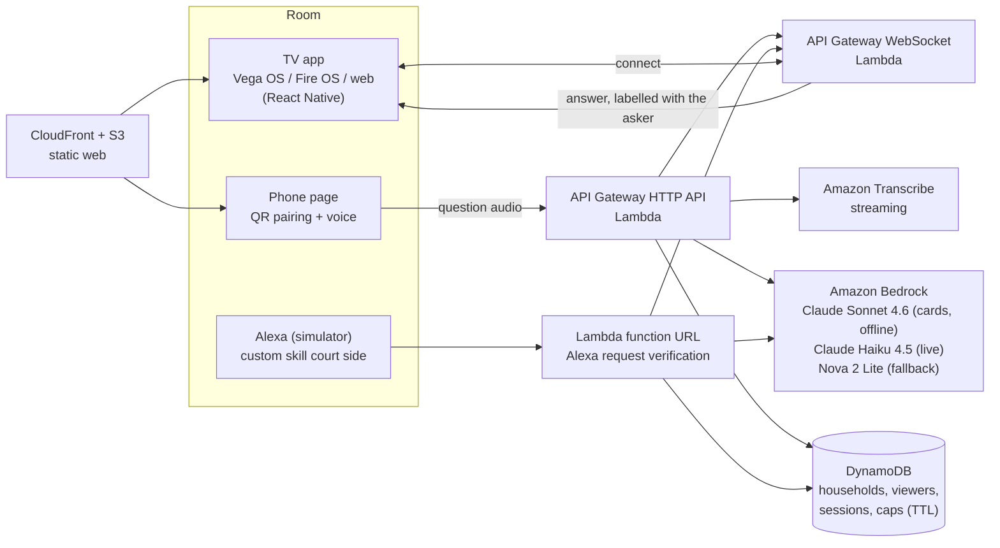

# Courtside

Courtside is a Fire TV app that explains each soccer moment to everyone in the living room at their own level. It replays a real match from open play-by-play data on a 2D pitch; every moment gets a card with up to three layers (basic, intermediate, tactical), and each viewer sees the layer for their level. It remembers which ideas each person has already understood, so a beginner who has learned "offside" is not told again and is moved up when ready. Anyone can ask a question by voice from their phone or, through an Alexa skill (tested in the simulator), from the room; the answer appears on the TV, labelled with who asked and written at their level. One shared React Native codebase targets Vega OS, Fire OS and the web. Built for the Amazon "Build, Ship, Shape" hackathon (Fire TV track).

## 60-second judge path

1. Open the live site, https://d3igz6igrmkgis.cloudfront.net/, and choose **TV**. It shows a six-character household code and a QR code. (The full TV app, with the pitch, cards and remote-control navigation, runs from `tv/` with `yarn web`, see below; the demo video shows it on a TV.)
2. On your phone, scan the QR code (or open **Phone** and type the code). Add yourself as a viewer and pick a level: beginner, fan or expert.
3. Tap the microphone and ask, for example, "why was that offside?". The clip is transcribed in our AWS account, answered at your level, and shown on the TV with your name. Typing works as a fallback.
4. Alexa (simulator, no device needed): open the Alexa developer console, skill **court side**, tab Test, locale en-US, development stage. Say or type "open court side", then "link household" and read the six characters from the TV once. Then "ask court side why was that offside". The simulator has no voice profiles, so say "this is Leo, why was that offside" to name the viewer; anyone else is Guest and is answered at the easiest level in the room.

## How the AI is kept honest

Language models invent soccer facts. Courtside does not let them.

- **Computed facts only.** The data pipeline computes the context first (minute and phase, score before and after, the effect on the score, a named pitch zone, the concept being taught, the 360 freeze frame where it matters). The prompt receives these facts and never raw coordinates.
- **Canonical definitions.** Jargon such as offside, penalty or yellow card is defined from a fixed catalogue based on the IFAB Laws of the Game (`src/core/definitions.ts`), not from the model's memory.
- **Deterministic checks on every card** (`checkCard`): word limits per layer, no coordinates, no FIFA or "World Cup" marks, no brackets, jargon defined in the basic layer, only known vocabulary.
- **A judge model** (a second call) reads each layer and rejects any number, claim or conclusion that is not in the computed facts; the basic layer must define every concept in plain words. A card that fails is regenerated with the problems listed, up to three times; a moment that never passes simply has no card and the app falls back.
- **Live questions** are answered from the same computed facts for the moment on screen, with a short word limit.

`npm run cards:generate` is incremental: it regenerates only moments that have no card yet or whose card fails today's checks (`npm run cards:generate -- --all` forces a full run) and refuses to write the file unless at least 90 % of moments end up with a card.

## Domain rules become tests

The behaviour that matters (who sees which layer, when a concept counts as understood, what a card may say) was written down as nine rules, R-01 to R-09, each with concrete examples, and approved by the product owner. `domain/rules/*.yaml` is the source of truth; `test/domain.test.ts` reads every YAML file and runs each approved example against the real code through a small adapter per rule. Approved examples must hold, rejected examples must fail, proposed ones are skipped. Change a rule in YAML and the tests change with it.

`domain/rules/R-01.yaml` (excerpt):

```yaml
id: R-01
rule: Every Moment teaches at least one Concept from the catalogue.
status: approved
examples:
  - id: R-01-b
    status: approved
    given: { event: { type: Pass, outcome: Pass Offside } }
    when: { curate: true }
    then: { concepts: [offside] }
```

and the adapter that makes it executable (`test/adapters/r01.ts`):

```ts
export const r01: Adapter = (given) => {
  const e = given.event;
  return { concepts: conceptsFor({ id: 'x', minute: 10, period: 1, team: 'A', type: e.type,
    shotType: e.shot_type, outcome: e.outcome, card: e.card }) };
};
// test/domain.test.ts: expect(actual).toMatchObject(ex.then)
```

`npm run domain:check` validates the YAML files themselves.

## Architecture



Pre-generation runs offline on a developer machine: StatsBomb events become Moments (`npm run data:build`), then cards (`npm run cards:generate`); the cards ship with the app as JSON. Only live questions, pairing and the viewer's learning state touch the backend. The pure domain core (`src/core`, no I/O) is shared by the backend, the web pages and the TV app.

## Privacy and cost caps

- No accounts and no passwords: a six-character household code is the only secret. Viewers are first names chosen by the household; nothing else about a person is stored.
- Phone audio goes only to our own AWS account for transcription; the recording is not stored, and the last answers are kept for one hour only so the TV can show them.
- Limits keep abuse and the bill bounded: 300 characters per question, 30 questions per hour per household, 300 per hour and 600 per day for the whole service, throttled APIs (10 requests per second), 5 failed Alexa links per Alexa account per hour, 20 wrong household codes per hour per source address (kept only as a salted hash for an hour). DynamoDB items expire through TTL; Lambda logs are kept for one month; API Gateway and CloudFront access logs are off so caller addresses are not stored.
- An AWS Budget of USD 20 per month guards the account.

## Run locally

Requirements: Node 24 or newer; AWS credentials only to generate cards or deploy.

```
npm install
npm test                    # root tests: domain rules, core, API, stack, Alexa
npm run typecheck
npm run web:dev             # phone and TV pages (Vite)

cd tv && yarn install       # Yarn 4 via Corepack, about 4 minutes
yarn test                   # TV tests
yarn web                    # full TV app on http://localhost:8082 (arrow keys, Enter, Backspace)
```

Vega OS builds (`tv/apps/vega`) need macOS or Ubuntu with the Vega SDK; see `tv/apps/vega/MAC-RUNBOOK.md`.

## Deploy

```
npm run web:build
npm run cdk -- deploy -c ownerEmail=<email> --outputs-file cdk-outputs.json
node scripts/smoke.mjs
```

The stack (`infra/lib/stack.ts`) is checked with cdk-nag; every suppression carries a written reason. Claude models on Bedrock need the account's use-case form; without access the code falls back to Nova 2 Lite.

## Documents

- `docs/reality.md`: research findings and decisions (what the platforms really allow).
- `docs/rulings.md`: technical decisions taken, with the cost if wrong.
- `docs/product-feedback.md`: answers to the hackathon's product-feedback questions, tool by tool.
- `friction-log.md`: every obstacle met, with workaround and suggestion.
- `design/direction.md`: the TV visual direction.

## Mini challenges

- **AWS Builder services used:** Amazon Bedrock (Claude Sonnet 4.6, Claude Haiku 4.5, Nova 2 Lite), Amazon Transcribe, AWS CDK, AWS Lambda, Amazon API Gateway (HTTP and WebSocket), Amazon DynamoDB, Amazon CloudFront and S3, AWS Budgets, plus the Alexa Skills Kit.
- **Open Source:** this repository is new for the hackathon and released under the MIT licence (`LICENSE`).

## Data and licence

Data: StatsBomb Open Data, https://github.com/statsbomb/open-data. The match data is StatsBomb's and is used under their open-data terms with attribution; the moment selection, explanations and analysis are ours. This is a non-commercial hackathon project; do not use the data commercially without StatsBomb's permission. The TV app is based on Amazon's multi-TV sample (see `tv/THIRD_PARTY.md`). Code licence: MIT.

## Alexa details

Skill "court side" (en-US, development stage, tested in the Alexa simulator). Say "link household" and the six character code from the TV once, then "ask court side why was that offside". The answer appears on the TV, labelled with who asked and written at their level. A recognised voice (personId) is answered as its linked viewer ("I am Leo"); the simulator has no voices, so "this is Leo, why was that offside" names the viewer instead; anyone else is Guest, answered at the easiest level in the room.

Trust model: the household code is the only secret. Everyone who has it, on the phone page or on Alexa, may choose any viewer name in the household, including by saying it. Failed links are limited to 5 per Alexa account per hour, and wrong household codes on the phone path to 20 per hour per source address (then HTTP 429 for that address only; the address is kept only as a salted hash for an hour), with a 5000 per hour backstop for the whole service. Alexa gives a skill 8 seconds; if the answer takes longer Alexa says so, but the answer can still arrive on the TV afterwards.
